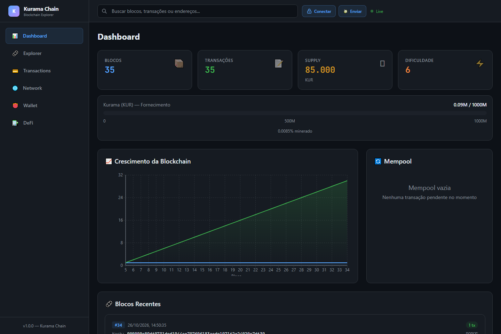
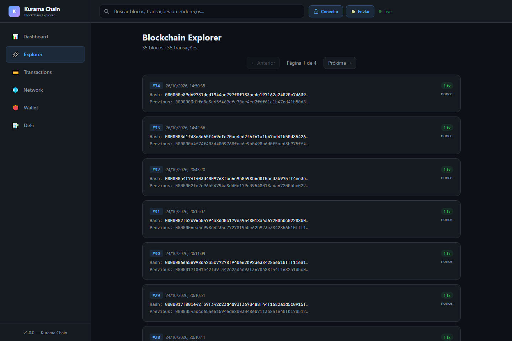
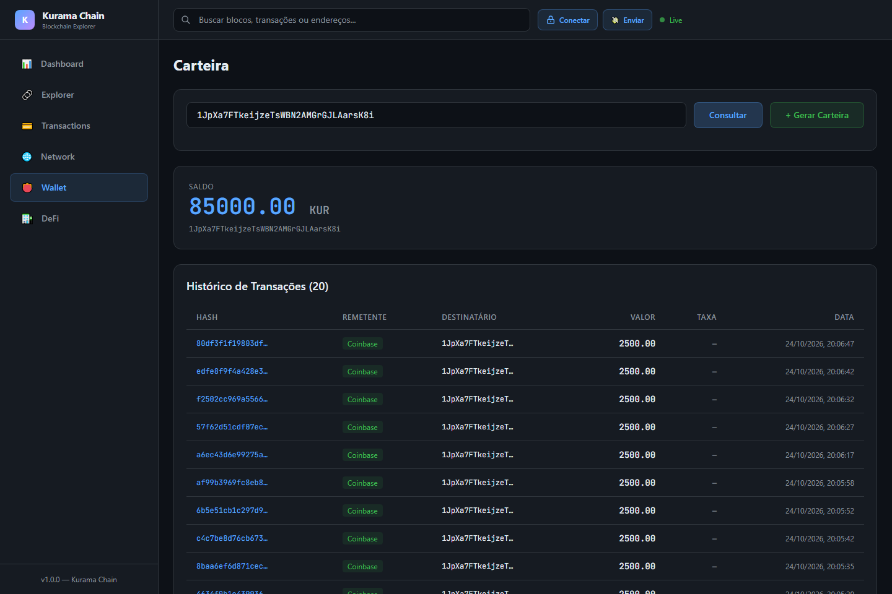
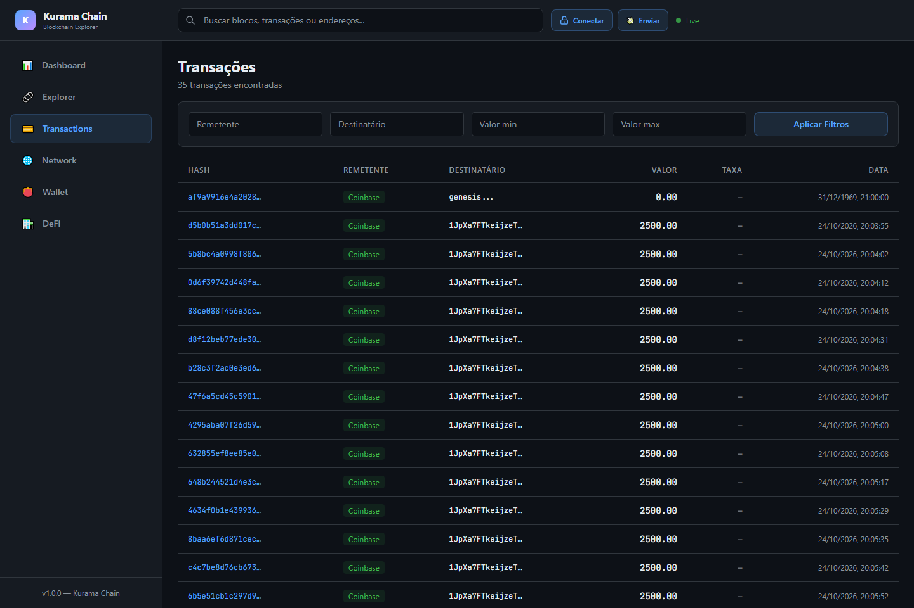
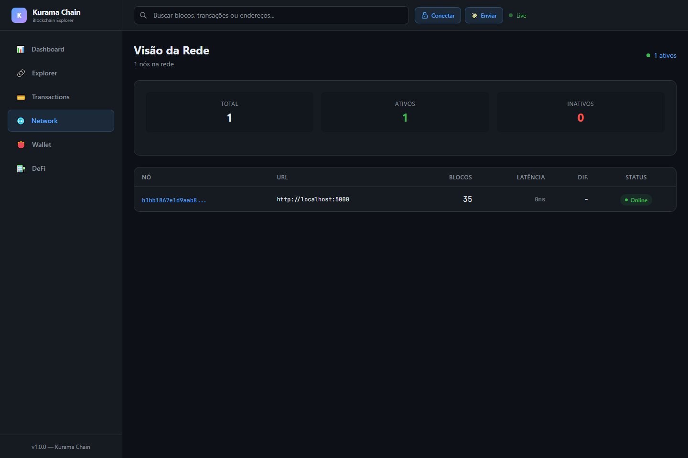
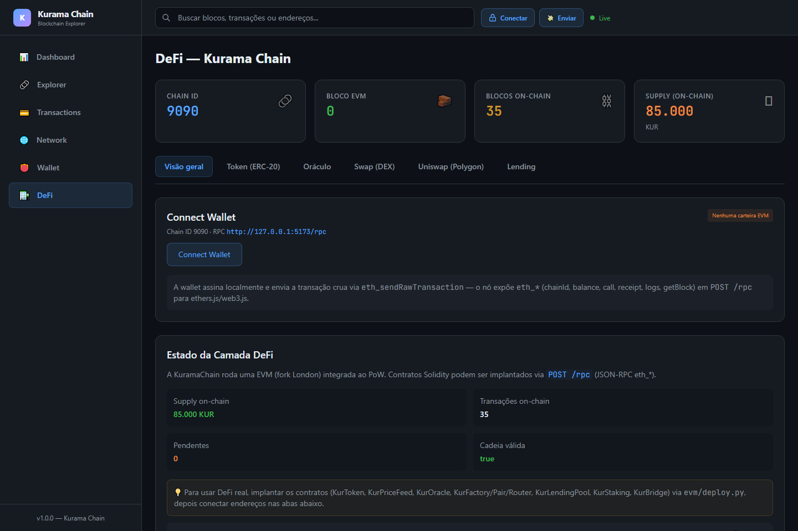

<p align="center">
  
  
  
  
  
  
</p>

<h1 align="center">⛓️ KuramaChain</h1>
<p align="center"><strong>Blockchain + Lightning Network</strong></p>
<p align="center">Uma implementação completa de blockchain com Proof of Work, carteiras ECDSA,<br>explorador visual e rede Lightning.</p>

<br>

<p align="center">
  <a href="#-visão-geral">Visão Geral</a> •
  <a href="#-arquitetura">Arquitetura</a> •
  <a href="#-primeiros-passos">Primeiros Passos</a> •
  <a href="#-blockchain">Blockchain</a> •
  <a href="#%EF%B8%8F-lightning-network">Lightning</a> •
  <a href="#-api-endpoints">API</a> •
  <a href="#-segurança">Segurança</a>
</p>

---

## 🎯 Visão Geral

O **KuramaChain** é uma blockchain própria escrita em Python com dois grandes módulos:

| Módulo | Descrição | Stack |
|--------|-----------|-------|
| ⛓️ **Blockchain Core** | Blockchain PoW com ECDSA, Merkle Tree, consenso, carteiras e explorer visual | Python, Flask, React |
| ⚡ **Lightning Network** | Canais de pagamento off-chain para transações instantâneas | Python, Flask |
| 🔷 **EVM / DeFi** | Smart contracts Solidity (ERC-20, DEX, oráculo, lending, staking, bridge) e JSON-RPC `eth_*` | Python, Solidity, py-evm |

> **Nota:** o cassino (Kurama Casino) **não faz mais parte deste projeto**. Foi
> extraído para um projeto separado e este repositório contém apenas a blockchain.

---

## 🏗️ Arquitetura

```
┌─────────────────────────────────────────────────────────────┐
│                      KURAMACHAIN                            │
├────────────────────────────┬────────────────────────────────┤
│   Blockchain Core          │   Lightning Network            │
├────────────────────────────┼────────────────────────────────┤
│ • Proof of Work            │ • Canais bidirecionais         │
│ • ECDSA/Wallets            │ • HTLCs                        │
│ • Merkle Tree              │ • Multi-hop routing            │
│ • Consenso P2P             │ • Disputas on-chain            │
│ • Mempool/SSE              │ • Fee management               │
└────────────────────────────┴────────────────────────────────┘
         ▲                              ▲
         │                              │
    ┌────┴────┐                    ┌────┴────┐
    │  Flask  │                    │  React  │
    │  (API)  │                    │(Frontend)│
    └─────────┘                    └─────────┘
```

---

## 🚀 Primeiros passos

Do zero ao primeiro bloco minerado em poucos minutos. Você precisa de
**Python 3.10+** e, só para o explorer, **Node 18+**.

### 1. Clone e instale

```bash
git clone https://github.com/Guildabitaxebrasil/casino-kurama.git
cd casino-kurama
pip install -r requirements.txt
```

### 2. Suba o nó — Terminal 1

```bash
python run.py --load
```

O nó atende em `https://localhost:5000` com certificado auto-assinado, então o
navegador avisa na primeira visita — é esperado em desenvolvimento (use
`--no-ssl` para HTTP puro). `--load` continua a cadeia de
`data/blockchain.json` com a dificuldade salva; sem ele, o nó começa uma
cadeia nova.

### 3. Minere — Terminal 2

```bash
python miner.py
```

O minerador encontra o nó sozinho, pede o bloco candidato e faz o PoW na sua
CPU, emendando bloco após bloco (Ctrl+C para parar). Sem `--address`, a
recompensa vai para o endereço do nó.

### 4. Receba em uma carteira sua (opcional)

Crie uma carteira em `POST /wallet/new` ou na aba **Carteira → Gerar Carteira**
do explorer e passe o endereço para o minerador:

```bash
python miner.py --address 15ZK...
```

### 5. Abra o explorer — Terminal 3

```bash
cd frontend
npm install
npm run dev
# Acesse http://localhost:5173
```

### Sem clonar nada (Windows)

O `baixar_minerador.bat` baixa só o minerador e já começa a minerar — veja a
seção **Baixar o minerador** mais abaixo.

### Se algo der errado

| Sintoma | Causa provável | O que fazer |
|---------|----------------|-------------|
| `nenhum nó respondendo em localhost:5000` | nó parado ou em outra porta | suba `python run.py --load`; se a porta mudou, use `python miner.py --port 5001` |
| Todo bloco volta `HTTP 409` | minerador antigo (sem dificuldade fracionária) | baixe o `miner.py` de novo: nó e minerador precisam da mesma versão |
| Blocos levando ~10 min cada | é o alvo do reajuste de dificuldade | normal; para testar rápido use `python run.py --difficulty 3` |
| Aviso de certificado no navegador | certificado auto-assinado de dev | aceite o aviso, ou suba o nó com `--no-ssl` |
| `Address already in use` | outra instância ocupando a porta 5000 | `python run.py --port 5001` e `python miner.py --port 5001` |
| `python` não encontrado ou versão antiga | Python abaixo de 3.10 | instale 3.10+ marcando "Add python.exe to PATH" |

### Rede multi-nó e demo

```bash
python run.py --network --nodes 3   # 3 nós simultâneos
python run.py --demo                # demonstração automatizada
```

### 📸 Explorer

| **Dashboard** | **Explorer** |
|:---:|:---:|
|  |  |
| **Carteira** | **Transações** |
|  |  |
| **Rede P2P** | **DeFi** |
|  |  |

---

## ⛓️ Blockchain

### 🔬 Como Funciona

**1. Proof of Work (Mineração)**
O minerador busca um **nonce** tal que `SHA-256(bloco + nonce)` comece com N zeros
hexadecimais — cada zero multiplica o trabalho por 16:
- Dificuldade 4 ≈ 65.536 tentativas em média
- Dificuldade 5 ≈ 1.048.576 tentativas
- Dificuldade 6 ≈ 16,7 milhões de tentativas
- A dificuldade é **fracionária**: `6.15` significa 6 zeros e o dígito seguinte
  ≤ `a`. Isso dá degraus de ~1,19x; com zeros inteiros os degraus eram de 16x
  (6 zeros ≈ 6 min e 7 zeros ≈ 100 min numa CPU doméstica), grosso demais
  para mirar o alvo
- Reajuste a cada 10 blocos, **proporcional** ao tempo real da janela
  (`delta = log16(alvo / real)`), com alvo de **10 min por bloco** e salto
  máximo de 1 por janela

**2. Assinaturas Digitais (ECDSA)**
Usamos **ECDSA com curva secp256k1** (a mesma do Bitcoin):
- Chave privada → assina transações
- Chave pública → verifica assinaturas
- Transações falsas são rejeitadas na validação

**3. Endereços (Base58Check)**
```
SHA-256(chave pública) → RIPEMD-160(digest) → prefixo 0x00 + checksum → Base58
```

**4. Árvore de Merkle**
Cada bloco contém uma raiz de Merkle que resume todas as transações, permitindo verificação eficiente de inclusão sem baixar o bloco inteiro.

**5. Consenso**
A cadeia válida **mais longa** é a correta. Nós substituem sua cadeia local ao receber uma cadeia mais longa e válida.

### ⛏️ Mineração na CPU (Proof of Work fora do nó)

Quem faz o PoW é o `miner.py`, como no Bitcoin: o nó só entrega o bloco
candidato (`GET /mining/template`) e valida o bloco pronto
(`POST /mining/submit`). O minerador procura o nonce na CPU até o hash
começar com os zeros exigidos pela dificuldade e emenda no bloco seguinte —
não há contador nem "próximo bloco agendado": você mina sem parar.

```bash
# Terminal 1 — o nó
python run.py --load

# Terminal 2 — o minerador (Ctrl+C para parar)
python miner.py

python miner.py --address 15ZK...        # recompensa para a sua carteira
python miner.py --blocks 2               # minera 2 blocos e sai (teste)
python miner.py --url http://meu-no:5000 # nó em outro endereço
```

O ritmo vem da dificuldade: o nó reajusta a cada 10 blocos mirando
`TARGET_BLOCK_TIME` (10 min) e, se ninguém minerar, o próximo bloco
simplesmente espera. Durante o PoW o minerador imprime o hashrate a cada 10s.

A dificuldade fica salva em `data/blockchain.json` e é mantida ao reiniciar
com `--load`: com `python run.py --load` ela continua de onde parou (só muda
se você passar `--difficulty`, que aceita fração, ex.: `--difficulty 6.15`).
Nó e minerador precisam estar na **mesma versão** — um minerador antigo não
reconhece dificuldade fracionária e tem os blocos recusados.

O nó valida tudo o que chega: PoW válido, `previous_hash` no topo da cadeia,
coinbase do tamanho exato da recompensa + fees e raiz de Merkle. Template
velho (outro bloco entrou) volta `409` e o minerador pede outro sozinho.

O nó salva a blockchain em `data/blockchain.json` **a cada bloco aceito**
(escrita atômica), sem depender do Ctrl+C.

### ⬇️ Baixar o minerador (sem clonar o projeto)

O `baixar_minerador.bat` baixa o `miner.py` mais recente do GitHub para
`%USERPROFILE%\KuramaMiner`, cria o ambiente Python (com `requests`) e já
começa a minerar — sem precisar do resto do repositório:

```bat
:: já dentro do repositório
baixar_minerador.bat

:: ou baixe e rode com um comando só (PowerShell)
powershell -c "irm https://raw.githubusercontent.com/Guildabitaxebrasil/casino-kurama/main/baixar_minerador.bat -OutFile baixar_minerador.bat; .\baixar_minerador.bat"
```

Parâmetros (opcionais):

```bat
baixar_minerador.bat                             :: nó em http://127.0.0.1:5000
baixar_minerador.bat http://meu-no:5000          :: nó em outro endereço
baixar_minerador.bat http://meu-no:5000 15ZK...  :: recompensa para uma carteira
```

Requer Python 3.10+ instalado (o script avisa se não encontrar). O minerador
baixado roda sozinho: quando o projeto não está por perto, usa a porta 5000
como padrão (a mesma de `config.py`).

### 🪟 Minerador sempre rodando (Windows)

Para o minerador subir junto com o Windows e se reiniciar sozinho, rode:

```bat
scripts\windows\install_miner_service.bat
```

O instalador registra `pythonw miner_service.py` no autostart do usuário
(não precisa de administrador), já inicia agora e grava a saída em
`data\miner_service.log`. Uma trava impede duas instâncias minerando. Para
remover: `scripts\windows\uninstall_miner_service.bat`.

O nó (`python run.py --load`) precisa estar rodando; sem ele o serviço
apenas registra a falha e tenta de novo a cada 30s.

### 📊 Blockchain Explorer

O frontend em React oferece 6 páginas para explorar a blockchain:

| Página | Rota | Descrição |
|--------|------|-----------|
| **Dashboard** | `/` | Visão geral com gráficos, estatísticas e últimos blocos |
| **Explorer** | `/blocks` | Blocos em cards com paginação |
| **Detalhes** | `/block/:id` | Hash, merkle, nonce, transações |
| **Transações** | `/transactions` | Tabela com filtros e busca |
| **Rede** | `/network` | Grafo interativo P2P (D3.js) |
| **Carteira** | `/wallet` | Saldo e histórico de endereço |

**Destaques visuais:**
- 📈 **ChainGrowthChart** — Gráfico de crescimento da blockchain (Recharts)
- 🔗 **NetworkGraph** — Grafo force-directed da rede P2P (D3.js)
- 🧱 **BlockChainVis** — Visualização horizontal de blocos encadeados
- 📋 **MempoolWidget** — Painel da mempool em tempo real
- 🌙 **Dark Theme** — Interface escura estilo Etherscan/GitHub Dark

---

## ⚡ Lightning Network

Implementação de **Lightning Network** para pagamentos off-chain:

- **HTLCs** (Hashed Time-Locked Contracts) — contratos condicionais com timeout
- **Canais Bidirecionais** — múltiplos pagamentos sem abrir nova tx on-chain
- **Roteamento Multi-hop** — pagamentos através de múltiplos nós intermediários
- **Disputas On-Chain** — resolução de conflitos via blockchain
- **Fee Management** — taxas ajustáveis por canal

```python
# Exemplo: abrir canal e pagar
POST /api/lightning/channel/open    # Abrir canal
POST /api/lightning/invoice         # Criar invoice
POST /api/lightning/pay             # Pagar invoice via rede
```

---

## 🔷 Camada EVM & DeFi

A blockchain roda uma **EVM (fork London)** integrada ao PoW: cada bloco minerado
sela um bloco EVM. Contratos Solidity são compilados com `solc` (`py-solc-x`) e
expostos por **JSON-RPC `eth_*`** em `POST /rpc` — o mesmo protocolo que
MetaMask, ethers.js e web3.js falam.

| Fase | Entregável | Contratos | Testes |
|------|-----------|-----------|--------|
| 0 | EVM + JSON-RPC `eth_*` | — | `tests/test_evm.py` |
| 1 | Token **ERC-20** | `KurToken.sol` | `tests/test_evm.py` |
| 2 | **DEX** (AMM `x*y=k`) + pools de liquidez (LP tokens) | `KurFactory.sol`, `KurPair.sol`, `KurRouter.sol` | `tests/test_dex.py` |
| 3 | **Oráculo** (feed Chainlink + TWAP de fallback) | `KurPriceFeed.sol`, `KurOracle.sol` | `tests/test_oracle.py` |
| 4 | **Lending** (Aave V2: depósito, empréstimo e liquidação por oráculo) | `KurLendingPool.sol`, `KurScaledToken.sol`, `KurPriceOracle.sol` | `tests/test_lending.py` |
| 5 | **Staking/Farming** (pools com recompensa por segundo) | `KurStaking.sol` | `tests/test_staking.py` |
| 5 | **Bridge** lock/mint com validadores m-de-n + relayer | `KurBridge.sol`, `KurWrappedToken.sol`, `evm/bridge.py` | `tests/test_bridge.py` |
| 6 | **Wallets/dApps** (JSON-RPC completo + card Connect Wallet + swap pela carteira) | `evm/rpc.py`, `frontend/src/api/evmWallet.ts`, `evmAbi.ts`, `dex.ts`, `uniswap.ts` | `tests/test_rpc_evm.py` |

### Swap assinado pela carteira

A aba **DeFi → Swap** executa o swap do DEX com a wallet (EIP-1193),
sem ethers.js/web3.js no bundle:

1. informe o endereço do **`KurRouter`** (ou defina `VITE_KUR_ROUTER` na build);
2. o par é descoberto on-chain (`router.factory()` → `getPair(tokenIn, tokenOut)`) —
   **qualquer par ERC-20** do `KurFactory` funciona, nos dois sentidos;
3. a cotação usa a fórmula do contrato (`x*y=k`, taxa 0,3%) e o slippage em bps;
4. se faltar allowance, a wallet assina `approve` e depois
   `swapExactTokensForTokens(amountIn, amountOutMin, [in, out], conta)`;
5. o valor recebido é lido do evento `SwapExecuted` no recibo.

A chave privada nunca sai da wallet. `eth_estimateGas` estima com o `from` real
(`evm/engine.py`) — um swap gasta ~134k, então o gas limit acompanha a transação.

### Uniswap V3 na Polygon (ponte de liquidez)

A aba **DeFi → Uniswap (Polygon)** troca nos pools reais da Uniswap V3 na Polygon
(chain 137), sem SDK: `frontend/src/api/uniswap.ts` lê o pool pelo RPC público
(`factory.getPool` → `slot0`/`liquidity`) e cota com o **QuoterV2**;
o swap é montado para o **SwapRouter02** e assinado pela carteira.

- a taxa do pool (0,01%/0,05%/0,3%/1%) é detectada pela liquidez, ou escolhida à mão;
- MATIC nativo entra como `value` e sai via `multicall([exactInputSingle, unwrapWETH9])`;
- `approve` é pedido só quando a allowance para o router é insuficiente;
- recotação imediata antes de assinar, com slippage em bps.

O card usa RPCs públicos por padrão (`polygon-bor-rpc.publicnode.com`, `1rpc.io/matic`,
`polygon.drpc.org`); para usar seu nó, defina `VITE_POLYGON_RPC_URL` no `frontend/.env`.

### Oráculo

- **`KurPriceFeed`** é compatível com `AggregatorV3Interface` (Chainlink): nós
  oráculo autorizados enviam o preço e a rodada fecha com a **mediana** quando o
  **quórum** de reporters é atingido — um reporter desonesto não move o preço.
- **`KurOracle`** lê o feed e, se ele estiver **obsoleto**, cai no **fallback
  TWAP** do par AMM (`KurPair` acumula preço × tempo em UQ112x112).
- **Nó oráculo Python** (`evm/oracle_node.py`) publica o preço off-chain no feed
  com guarda de desvio (anti "fat finger"):

```python
from evm.deploy import deploy_price_feed
from evm.engine import EVMEngine
from evm.oracle_node import KurOracleNode, RandomWalkSource

engine = EVMEngine()
_, feed = deploy_price_feed(engine)   # aplica os defaults EVM_ORACLE_*

node = KurOracleNode(engine=engine, feed=feed, source=RandomWalkSource(2500.0))
node.publish_once()      # publica uma vez
node.run(interval=60)    # loop contínuo
```

### Lending (mercado de empréstimos)

- **`KurLendingPool`** (fork do Aave V2): deposita e recebe **aToken** (colateral
  que rende juros), toma emprestado a **taxa variável** (vira **debtToken**) e
  **liquida** posições subcolateralizadas quando o `healthFactor` cai abaixo de
  1. A taxa segue a utilização: `base + slope1·u/ótima` e, acima da utilização
  ótima, `+ slope2`.
- **`KurPriceOracle`** liga cada ativo ao seu **feed AggregatorV3** (Fase 3) e
  normaliza o preço em 18 decimais; preço **obsoleto reverte** (nunca se calcula
  colateral com preço velho).
- **Liquidação por oráculo**: quem liquidar paga parte da dívida (limitada pelo
  `closeFactor`) e recebe o colateral equivalente **mais o bônus** (`liquidationBonus`).

```python
from evm.deploy import deploy_lending_pool, deploy_price_oracle, init_reserve

_, prices = deploy_price_oracle(engine)            # idades/taxas do config
_, pool = deploy_lending_pool(engine, prices)
_, (aToken, debtToken) = init_reserve(engine, pool, token)   # LTV/limiar/bônus do config

# depois, via pool: deposit / withdraw / borrow / repay / liquidationCall
# e getUserAccountData(address) → (colateral, dívida, disponível, limiar, ltv, healthFactor)
```

### Staking (pools de recompensa)

- **`KurStaking`** é um farm multi-pool (modelo `accRewardPerShare`): cada pool
  aceita um token (KUR, LP token do DEX) e paga recompensa por segundo em outro
  token. Stake KUR → ganha KUR é suportado.
- As recompensas saem de um **orçamento** (`fundPool`), nunca do principal: sem
  orçamento o `claim` reverte, mas o `withdraw` do principal continua funcionando
  (e há `emergencyWithdraw`).

```python
from evm.deploy import create_staking_pool, deploy_staking, fund_staking_pool, stake_tokens

_, staking = deploy_staking(engine)
_, pid = create_staking_pool(engine, staking, kur, kur, rate, reward_end)
fund_staking_pool(engine, staking, pid, 1_000 * 10**18)   # abastece o orçamento
stake_tokens(engine, staking, pid, 100 * 10**18)           # stake/claim/unstake
```

### Bridge (interoperabilidade)

- **`KurBridge`** conecta a KuramaChain a outras redes no modelo **lock/mint**:
  o ativo é travado na origem (`deposit`) e o **`KurWrappedToken`** é cunhado no
  destino; na volta o wrapped é **queimado** e o ativo travado é liberado.
- O saque exige **`threshold` assinaturas** de validadores distintos sobre o
  digest EIP-191 do depósito — `depositId` não pode ser processado duas vezes e
  a mensagem amarra as duas chains, o bridge, o destinatário e o valor.
- **`evm/bridge.py`** traz o digest/assinatura e um **relayer** que lê os eventos
  `Deposit` e envia o `withdraw` no destino.

```python
from evm.bridge import BridgeRelayer
from evm.deploy import deploy_bridge, deploy_wrapped_token, register_wrapped

_, bridge = deploy_bridge(engine)                        # validadores/threshold do config
_, wrapped = deploy_wrapped_token(engine, 'Wrapped KUR', 'wKUR', bridge)
register_wrapped(engine, bridge, 9090, kur, wrapped)     # (chain remota, token) → wrapped

relayer = BridgeRelayer(source_engine, dest_engine, bridge_a, bridge_b, validator_keys)
relayer.process()                                        # origem → destino
```

> A arquitetura completa (fases, decisões e riscos) está em
> [`DEFI_ARCHITECTURE.md`](DEFI_ARCHITECTURE.md).

---

## 📡 API Endpoints

### Blockchain Core

| Método | Rota | Descrição |
|--------|------|-----------|
| `GET` | `/chain` | Blockchain completa |
| `POST` | `/mine` | Minerar novo bloco (PoW no próprio nó) |
| `GET` | `/mining/template` | Bloco candidato para minerar fora do nó |
| `POST` | `/mining/submit` | Aceitar bloco com o PoW resolvido na CPU |
| `POST` | `/transactions/new` | Criar transação |
| `GET` | `/transactions/pending` | Transações pendentes |
| `POST` | `/wallet/new` | Gerar carteira |
| `GET` | `/balance/<address>` | Saldo |
| `POST` | `/nodes/register` | Registrar nó vizinho |
| `GET` | `/nodes/resolve` | Executar consenso |
| `GET` | `/validate` | Validar cadeia |
| `GET` | `/stats` | Estatísticas |
| `GET` | `/api/events` | Eventos em tempo real (SSE) |
| `GET` | `/api/docs` | Documentação Swagger |
| `POST` | `/rpc` | JSON-RPC `eth_*` da EVM (MetaMask / ethers.js / web3.js) |

### EVM JSON-RPC (`POST /rpc`)

| Método | Para quê |
|--------|----------|
| `eth_chainId`, `net_version`, `web3_clientVersion` | identificar a rede (chain ID **9090**) |
| `eth_blockNumber`, `eth_gasPrice`, `eth_feeHistory` | estado/gas para a wallet |
| `eth_getBalance`, `eth_getTransactionCount`, `eth_getCode`, `eth_getStorageAt` | estado de contas/contratos |
| `eth_call`, `eth_estimateGas` | leitura/execução simulada |
| `eth_sendRawTransaction` | transação assinada pela wallet |
| `eth_getTransactionReceipt` (com **logs**), `eth_getTransactionByHash` | recibo/histórico |
| `eth_getBlockByNumber`, `eth_getBlockByHash`, `eth_getBlockTransactionCountBy*` | blocos |
| `eth_getLogs` | eventos (filtro de endereço/topics) |

### Lightning Network

| Método | Rota | Descrição |
|--------|------|-----------|
| `POST` | `/api/lightning/channel/open` | Abrir canal |
| `POST` | `/api/lightning/channel/close` | Fechar canal |
| `GET` | `/api/lightning/channels` | Listar canais |
| `POST` | `/api/lightning/invoice` | Criar invoice |
| `POST` | `/api/lightning/pay` | Pagar invoice |
| `GET` | `/api/lightning/network/graph` | Grafo da rede LN |

---

## 🛡️ Segurança

### Criptografia

| Algoritmo | Uso |
|-----------|-----|
| **SHA-256** | Hashing de blocos, Merkle tree |
| **ECDSA (secp256k1)** | Assinatura de transações |
| **RIPEMD-160** | Geração de endereços |
| **Base58Check** | Codificação de endereços |
| **AES-256-GCM** | Criptografia de chaves privadas |
| **PBKDF2-HMAC-SHA256** | Derivação de chave (100k iterações) |
| **HMAC-SHA256** | Autenticação P2P entre nós |

### Proteções de Rede

- **Rate Limiting** multi-camada (IP + wallet + adaptativo)
- **Anti-DNS Rebinding** — verificação de IP por requisição
- **Anti-Replay** — nonce + timestamp em mensagens P2P
- **Peer Scoring** — banimento progressivo de peers maliciosos
- **Content-Security-Policy** — headers restritivos no frontend

---

## 📁 Estrutura do Projeto

```
kuramachain/
├── api/                           # API REST (Flask)
│   ├── routes.py                  # Endpoints principais
│   └── __init__.py
├── core/                          # Blockchain Core
│   ├── blockchain.py              # Blockchain, consenso, eventos
│   ├── block.py                   # Bloco com PoW
│   ├── transaction.py             # Transações e assinaturas
│   ├── wallet.py                  # Carteiras ECDSA
│   ├── crypto_utils.py            # SHA-256, ECDSA, Base58, Merkle
│   ├── identity.py                # Identidade persistente de nós
│   └── p2p_security.py            # Segurança P2P (nonce, scoring)
├── lightning/                     # Lightning Network
│   ├── lightning_network.py       # Rede LN
│   ├── channel.py                 # Canais de pagamento
│   ├── channel_manager.py         # Gerenciamento de canais
│   ├── htlc.py                    # HTLCs
│   ├── router.py                  # Roteamento multi-hop
│   └── api.py                     # API LN
├── evm/                           # Camada EVM + DeFi (Solidity)
│   ├── engine.py                  # EVM (py-evm, fork London) + selagem no PoW
│   ├── rpc.py                     # JSON-RPC eth_*
│   ├── compiler.py                # Compilação de contratos (solc)
│   ├── oracle_node.py             # Nó oráculo (preço off-chain → on-chain)
│   ├── bridge.py                  # Atestação/digest + relayer do bridge
│   ├── deploy.py                  # Deploy dos contratos (orcáculo, lending, staking, bridge)
│   └── contracts/                 # ERC-20, DEX, Oráculo, Lending, Staking, Bridge
├── node/                          # Gerenciamento de nós
│   └── node_manager.py            # Rede multi-nó
├── frontend/                      # Blockchain Explorer (React)
├── docs/screenshots/              # Prints do explorer usados neste README
├── tests/                         # Testes
├── config.py                      # Configurações centralizadas
├── run.py                         # Ponto de entrada
└── requirements.txt               # Dependências Python
```

---

## 🧪 Testes

```bash
# Todos os testes
python -m pytest tests/ -v

# Testes específicos
python -m pytest tests/test_blockchain.py -v    # Blockchain
python -m pytest tests/test_lightning.py -v     # Lightning Network
python -m pytest tests/test_api.py -v           # API
python -m pytest tests/test_miner.py -v         # Minerador (PoW na CPU + template/submit)
python -m pytest tests/test_evm.py -v           # EVM + ERC-20 + JSON-RPC
python -m pytest tests/test_dex.py -v           # DEX (AMM x*y=k + LP tokens)
python -m pytest tests/test_oracle.py -v        # Oráculo (feed + TWAP)
python -m pytest tests/test_lending.py -v       # Lending (depósito/empréstimo/liquidação)
python -m pytest tests/test_staking.py -v       # Staking (pools + recompensas)
python -m pytest tests/test_bridge.py -v        # Bridge (lock/mint + relayer)
python -m pytest tests/test_rpc_evm.py -v       # JSON-RPC para MetaMask/dApps
```

---

## 🛠️ Tecnologias

### Backend
| Tecnologia | Versão | Uso |
|------------|--------|-----|
| Python | 3.10+ | Linguagem principal |
| Flask | 2.x | API REST |
| Pytest | 7.x | Testes |

### Frontend
| Tecnologia | Versão | Uso |
|------------|--------|-----|
| React | 18 | UI |
| TypeScript | 5 | Tipagem |
| Vite | 5 | Build |
| TailwindCSS | 3 | Estilização |
| Recharts | 2 | Gráficos |
| D3.js | 7 | Network graph |
| Axios | 1 | HTTP client |
| Lucide React | - | Ícones |

---

## 📄 Licença

Todos os direitos reservados. KuramaChain é uma blockchain com Proof of Work, carteiras ECDSA e rede Lightning.

---

<p align="center">
  <strong>KuramaChain</strong> — Python · Flask · React · TypeScript · TailwindCSS · Lightning Network
</p>
